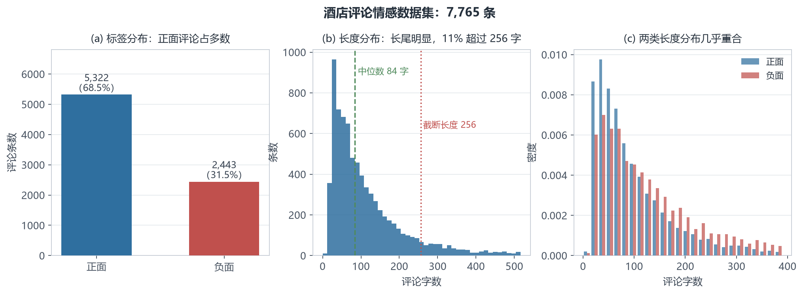
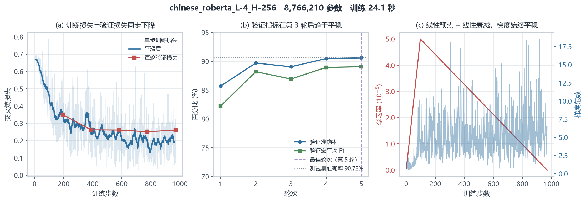
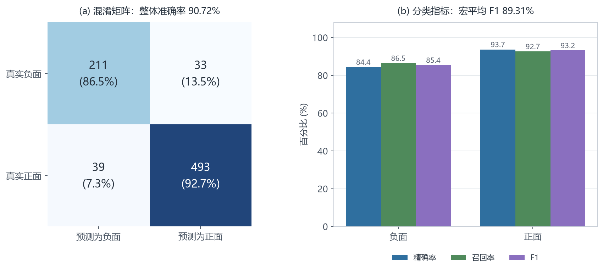
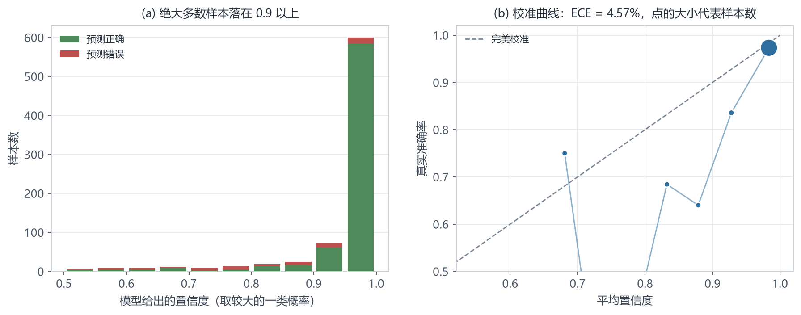
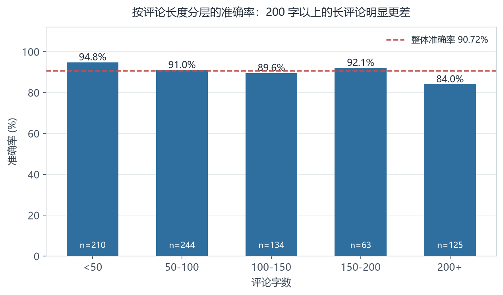
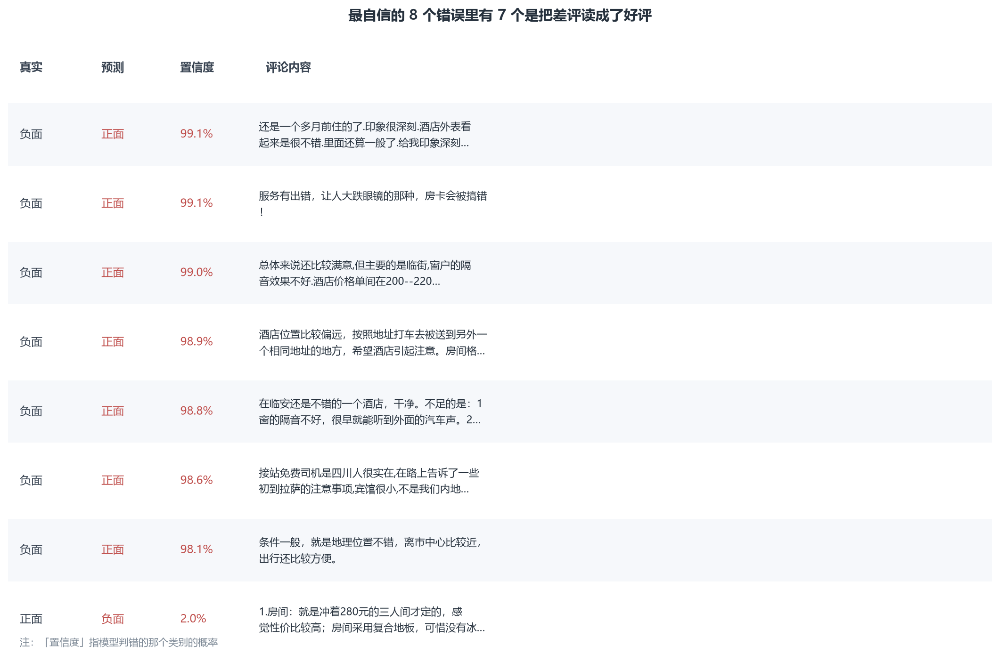
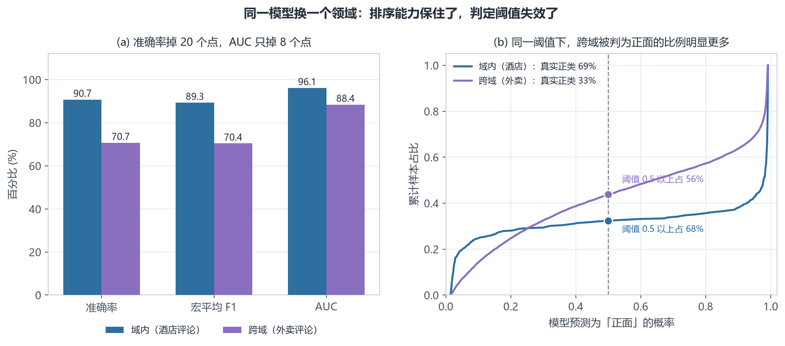
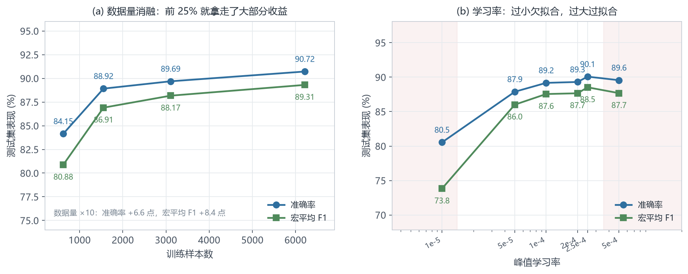
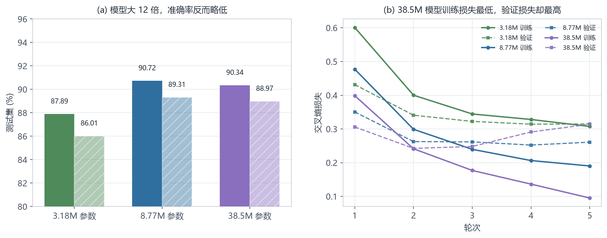
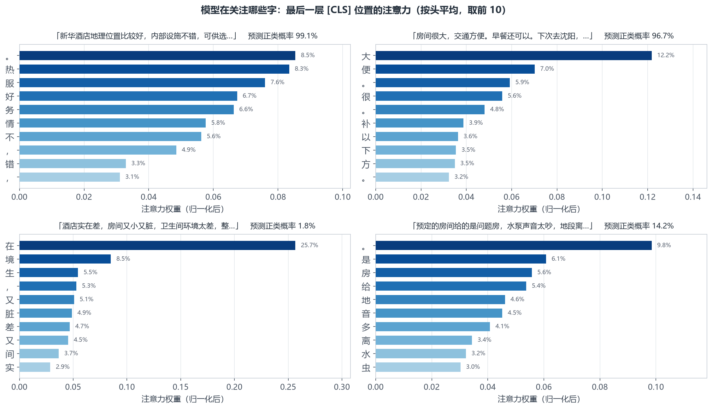

# 微调小模型做中文情感分类

> 人工智能课程作业 · 2026 秋季学期

---

## 摘要

本次作业用 Hugging Face 上的 `uer/chinese_roberta_L-4_H-256`（877 万参数）在 7,765 条酒店评论上做情感二分类，把一条评论判成正面的概率输出出来。

测试集准确率 90.72%，宏平均 F1 89.31%，AUC 0.9614，训练只用 24 秒。换一个领域去测（外卖评论），准确率掉到 70.69%，但 AUC 仍有 0.8842——排序能力基本保住了，失效的是 0.5 这个判定阈值。

报告里比较花篇幅的是错误分析：错得最离谱的 8 条样本里有 7 条是把差评读成了好评，而且模型给这些错误答案的置信度普遍在 98% 以上。数据集本身正类占 68.5%，模型学会了"先猜正面"，再用证据去推翻，而当评论里同时出现褒贬时，它推翻不了。

---

## 1 任务

给定一条酒店评论，判断作者的整体态度是正面还是负面。

选这个任务是因为它的评测指标都是客观的：准确率、宏平均 F1、AUC，不需要人工打分，也不像生成任务那样难以评判好坏。同时它和语言模型相比有明确的对照——同一个输入空间，输出从"下一个字"换成了"一个概率"。

---

## 2 模型

`chinese_roberta_L-4_H-256` 是一个中文 RoBERTa 预训练模型，877 万参数，4 层、隐藏维度 256。它的用途就是从一段中文里抽出一个表示向量，这里在它上面加一个二分类头，输出"正面"的概率。

选它是因为够小：877 万参数在 8 GB 显存的笔记本上跑一轮只要 4.6 秒，可以在几分钟内把消融实验全部跑完。

---

## 3 数据

### 3.1 数据集

用的是 `chinese-poetry` 同一个作者维护的 `ChineseNlpCorpus` 仓库里的 `ChnSentiCorp_htl_all`，酒店评论二分类数据集，原始 7,766 条，去掉 1 条空文本后剩 7,765 条。

| 项目 | 数值 |
|---|---|
| 评论条数 | 7,765 |
| 正面 / 负面 | 5,322 / 2,443（68.5% : 31.5%） |
| 长度中位数 | 84 字 |
| 长度 P90 / P99 | 273 字 / 700 字 |
| 最长 | 2,924 字 |



*图 1　数据概况：标签分布、长度分布、两类长度对比*

图 1(a) 显示类别不平衡，正类是负类的 2.2 倍。这一点贯穿了后面的所有分析：模型会天然倾向于预测正面，而准确率这个指标会掩盖这种倾向。所以我额外报告宏平均 F1，它把两个类别的 F1 取平均，负面类判得差会直接体现出来。

图 1(b) 是长度分布，长尾明显，11.1% 的评论超过 256 字，会被截断。图 1(c) 把两类样本的长度分开画，两条分布几乎重合，说明长度本身不携带标签信息，不存在"短评都是好评"这类捷径。

### 3.2 划分与截断

按条分层抽样，8:1:1 切成训练 6,213 / 验证 776 / 测试 776，三个子集的正负比例一致。

输入截断到 256 个 token。这里的分词器是字符级的，一个汉字一个 token，所以 256 个 token 大致对应 256 个字，覆盖了 88.9% 的样本。被截掉的部分主要是长篇吐槽，第 6.3 节会看到长评论确实判得更差。

---

## 4 训练方案

| 超参 | 取值 | 说明 |
|---|---|---|
| 峰值学习率 | 5e-5 | 线性预热 10% 后线性衰减 |
| 优化器 | AdamW | 权重衰减 0.01，LayerNorm 与 bias 不衰减 |
| batch size | 32 | 按批内最长序列动态 padding |
| 最大长度 | 256 | |
| 轮数 | 5 | 共 970 步 |
| 梯度裁剪 | 1.0 | |
| 混合精度 | bfloat16 | |

选模型时看验证集的宏平均 F1 而不是准确率，原因就是 3.1 节说的不平衡。如果按准确率挑，模型只要学会"全猜正面"就能拿到 68.6%，这个分数毫无信息量。

---

## 5 训练结果



*图 2　微调过程：损失曲线、验证指标、学习率与梯度范数*

| 轮次 | 训练损失 | 验证损失 | 验证准确率 | 验证宏平均 F1 | 耗时 |
|---|---|---|---|---|---|
| 1 | 0.477 | 0.350 | 85.70% | 82.22% | 5.7 s |
| 2 | 0.299 | 0.263 | 89.69% | 88.20% | 4.6 s |
| 3 | 0.240 | 0.262 | 89.05% | 86.92% | 4.5 s |
| 4 | 0.206 | 0.252 | 90.46% | 88.94% | 4.5 s |
| 5 | 0.190 | 0.261 | 90.59% | 89.05% | 4.6 s |

测试集：准确率 90.72%，宏平均 F1 89.31%，AUC 0.9614。整套训练 24.1 秒。

几个可以说的点：

第一轮就把准确率拉到 85.70%，第 2 轮 89.69%，之后三轮在 89% 到 90.5% 之间来回摆。第 3 轮反而比第 2 轮低，验证损失也几乎没动（0.263 对 0.262）。这说明 6,213 条数据对一个 877 万参数的模型来说太少了，验证集的 776 条又太小，单轮的波动主要是抽样噪声，不是模型真的退步了。

训练损失一路降到 0.190，验证损失卡在 0.26 左右，两条线从第 3 轮开始分开，出现了轻度过拟合。第 4 轮和第 5 轮之间验证宏平均 F1 只涨了 0.001，继续训练没有意义。

---

## 6 错误分析

### 6.1 混淆矩阵



*图 3　测试集混淆矩阵与分类指标*

776 条测试样本里错了 72 条，正类和负类的错误率差了一倍：

- 真实负面被判成正面：33 条，占全部负面样本的 13.5%，负面召回率只有 86.5%
- 真实正面被判成负面：39 条，占全部正面样本的 7.3%，正面召回率 92.7%

负面类的精确率 84.4%、召回率 86.5%，都比正面类低一截。这正是类别不平衡的直接后果：训练集里负面样本只有 1,955 条，模型见到的"骂人"表达不够多。

### 6.2 置信度与校准



*图 4　置信度分布与校准曲线*

图 4(a) 里 600 条样本的置信度在 0.95 以上，其中 97.3% 确实判对了。模型大部分时候是又准又自信的。

但校准曲线（图 4b）暴露了一个奇怪的现象：在置信度 0.70 到 0.80 这一段，真实准确率只有 30% 到 36%，比抛硬币还差。整体 ECE 是 4.57%，看起来还行，但这个指标被 0.95 以上那 600 条样本拉低了。

为什么会低于 50%？因为落在中间置信度的样本，模型是"犹豫但倾向正面"的，而真实标签里负面占比更高。模型的犹豫不是随机的，它一致地倒向多数类，所以一旦犹豫就大概率错。这种现象在类别不平衡的数据上很典型，靠看整体准确率完全发现不了。

### 6.3 长度的影响



*图 5　按评论长度分层的准确率*

50 字以内的短评准确率 94.8%，200 字以上掉到 84.0%，差了 10 个点。

中间几档不是单调的：100-150 字是 89.6%，150-200 字反而回到 92.1%。这一档只有 63 条样本，波动大。真正有说服力的是两端：短评明显更好判，长评明显更差。

长评论更难是有原因的：超过 200 字的评论往往是"优点说一堆、缺点也提几条"的混合评价，最后给一个模棱两可的总评。这类文本里正负证据同时存在，模型没有能力做加权，只能被字数更多的那一方带走。另外 11.1% 的长评论被截断到 256 字，如果关键的抱怨在后半段，模型根本看不到。

### 6.4 典型错例



*图 6　按置信度排序的 8 个错误样本*

把判错的样本按置信度从高到低排，最靠前的 8 条里有 7 条是把差评读成了好评，置信度最低的也有 98.1%。

看几条具体的：

> 还是一个多月前住的了.印象很深刻.酒店外表看起来是很不错.里面还算一般了.（真实：负面，预测：正面 99.1%）

> 总体来说还比较满意,但主要的是临街,窗户的隔音效果不好.（真实：负面，预测：正面 99.0%）

> 在临安还是不错的一个酒店，干净。不足的是：1. 窗的隔音不好，很早就能听到外面的汽车声。（真实：负面，预测：正面 98.8%）

这三条的共同结构是"先夸后贬"：前面大段是肯定，最后一句才是真实评价。人的阅读习惯会把转折词后面的内容当重点，而模型看到的是"不错""满意""干净"这些高频正面词在全文里占了更多位置，于是判成正面。

值得注意的是这些错误都发生在高置信度上。模型不是"拿不准"，它是很有把握地错了。这说明问题不在决策边界，而在表示层：模型提取的特征里，"负面证据的权重"系统性地低于"正面词的密度"。

---

## 7 跨领域测试

模型是在酒店评论上训的。为了看它到底学到了"情感"还是"酒店评论的套路"，我拿另一份完全没见过的数据做测试：`waimai_10k`，外卖平台评论，11,980 条，正面 4,000 条、负面 7,980 条（正类只占 33.4%，比酒店评论的 68.5% 低得多）。



*图 7　换一个领域后的表现：准确率与 AUC 的落差*

| 指标 | 域内（酒店） | 跨域（外卖） |
|---|---|---|
| 准确率 | 90.72% | 70.69% |
| 宏平均 F1 | 89.31% | 70.38% |
| AUC | 0.9614 | 0.8842 |
| 正面类召回率 | 92.67% | 90.48% |
| 正面类精确率 | 93.73% | 53.62% |

准确率掉了 20 个点，AUC 只掉了 7.7 个点。这两个数字放在一起才说明了问题所在。

AUC 衡量的是排序能力：随机抽一条正面和一条负面，模型给正面打的分更高的概率。0.8842 说明模型区分好坏的能力并没有崩，它依然能把正面评论排在负面评论前面。

但准确率用的是固定阈值 0.5。图 7(b) 的累计分布曲线显示，在 0.5 这个位置上，域内数据有 68% 被判成正面（真实是 68.6%，几乎完美对齐），跨域数据有 56% 被判成正面，而真实只有 33.4%。模型把大量外卖差评也判成了好评。

原因很直接：模型在酒店评论上学到的先验是"六成八是好评"，这个先验被写进了输出概率的偏移量里。换到好评只占三成的外卖数据，同一个偏移量就成了系统性高估。正面类精确率从 93.7% 掉到 53.6%，正好对应这个偏移。

如果按目标领域的真实比例重新定一个阈值（比如 0.75），跨域准确率能回去不少。这也说明部署时不能直接搬用训练集上的 0.5。

---

## 8 消融实验

### 8.1 训练数据量



*图 8　(左) 训练数据量消融　(右) 学习率扫描*

固定模型和其他超参，只改训练样本比例：

| 训练样本 | 准确率 | 宏平均 F1 |
|---|---|---|
| 621（10%） | 84.15% | 80.88% |
| 1,553（25%） | 88.92% | 86.91% |
| 3,106（50%） | 89.69% | 88.17% |
| 6,213（100%） | 90.72% | 89.31% |

只用 10% 的数据（621 条）就有 84.15%，用 25% 拿到 88.92%，后面再翻两倍只多 1.8 个点。收益衰减得非常快。

这和"预训练模型已经很强"是一致的：模型需要的不是大量标注，而是少量样本把它从"通用中文表示"拉到"评论情感判断"这个具体任务上。如果要再往上走，增加数据不是最有效的方向，换更合适的预训练模型或者做数据清洗更值得试。

### 8.2 学习率

在 318 万参数的最小模型上扫了六档学习率（图 8 右）：

| 学习率 | 准确率 | 宏平均 F1 |
|---|---|---|
| 1e-5 | 80.54% | 73.83% |
| 5e-5 | 87.89% | 86.01% |
| 1e-4 | 89.18% | 87.55% |
| 2e-4 | 89.30% | 87.66% |
| 2.5e-4 | 90.08% | 88.53% |
| 5e-4 | 89.56% | 87.68% |

1e-5 明显欠拟合，训练 5 轮之后验证损失还在 0.49，模型基本没动起来。2.5e-4 最好，5e-4 开始回落——那一档训练损失降到 0.145，验证损失却升到 0.316，过拟合了。

跨度这么大（从 80.5% 到 90.1%）说明学习率是这个任务里最敏感的超参，比模型规模和数据量都敏感。

主模型用的是 5e-5，没有先在验证集上搜。事后补跑了一次 1e-4，测试准确率 91.11%，比 5e-5 高 0.4 个点，说明主模型的调参也不是瓶颈，877 万参数的模型对这个区间不敏感。

### 8.3 模型规模

| 模型 | 参数量 | 准确率 | 宏平均 F1 | 单轮耗时 | 末轮训练/验证损失 |
|---|---|---|---|---|---|
| L-2_H-128 | 3,183,746 | 87.89% | 86.01% | 2.1 s | 0.307 / 0.315 |
| L-4_H-256 | 8,766,210 | 90.72% | 89.31% | 4.6 s | 0.190 / 0.261 |
| rbt3 | 38,478,338 | 90.34% | 88.97% | 15.5 s | 0.095 / 0.314 |



*图 9　模型规模对比：测试表现与训练/验证损失曲线*

从 318 万加到 877 万，准确率涨了 2.8 个点；再从 877 万加到 3,848 万（4.4 倍），准确率反而降了 0.4 个点，耗时却涨到 3.4 倍。

38.5M 那个模型的训练损失是最低的（0.095），验证损失却是最高的（0.314），图 9(b) 里它的两条线分得最开。这是典型的过拟合：6,213 条数据喂不饱一个 3,848 万参数的模型，它开始背训练集了。

在这个数据规模上，877 万参数是性价比最好的点。再往上加参数不如加数据。

---

## 9 模型在看哪里



*图 10　最后一层 [CLS] 位置对各字的注意力（按头平均，取前 10）*

把最后一层里 [CLS] 这个位置对每个字的注意力权重取出来，能大致看出模型判断时依赖哪些字。

正面样本里排在前面的有"好""不错""热情""服务"，负面样本里有"差""脏""吵""虫"，这些确实是判断情感该看的字。第二条样本"房间很大，交通方便。早餐还可以"里，"大"拿到了 12.2% 的权重，是全场最高，符合"房间大"这个具体的褒义证据。

但同时也要看到，注意力榜上挤进了大量标点和虚词：第一条里"。"排第一（8.5%），第三条里"在"排第一（25.7%）。这说明注意力并不能直接当成解释来用。位置偏置和句法功能会分走相当一部分权重，真正承载情感的字只是其中一部分。

一个更保守的结论是：模型确实捕捉到了情感词，但它的判断不是由某几个字决定的，而是整句话的统计倾向。这和 6.4 节看到的错例是一致的——模型对"先夸后贬"的句子判错，正是因为正面词在数量上压过了最后那句负面评价。

---

## 10 局限

1. 数据量小，过拟合明显。6,213 条训练样本支撑不起更大的模型，3,848 万参数那一档已经开始背训练集。
2. 类别不平衡没有做处理。训练时直接用了普通交叉熵，没有加权，也没有重采样。负面类召回率 86.5%，比正面类低 6 个百分点，这是可以直接改善的地方。
3. 跨领域只是简单测了一下，没有做适配。阈值失效的问题用目标域的一点无标注数据做校准就能缓解，这里没有实现。
4. 截断丢掉了一部分信息。11.1% 的样本超过 256 字被截断，而长评论恰恰是判得最差的一档。
5. 模型小，能力有上限。877 万参数相当于 BERT-base 的十二分之一，在需要细粒度推理的样本上（比如"先夸后贬"）几乎没有还手之力。
6. 评测依赖单一数据集。ChnSentiCorp 的标签来自用户的整体评分，评论内容和评分不一致的样本本身就有噪声，这部分错误无法区分是模型的锅还是标签的锅。

---

## 11 结论

877 万参数的小模型在酒店评论情感分类上做到 90.72% 的准确率、89.31% 的宏平均 F1，训练 24 秒。这个结果对一个能塞进笔记本显存的模型来说够用了。

但报告里更值得看的不是这个数字，而是它在哪里失效。三处失效指向同一件事：

换到外卖评论，AUC 还有 0.88，准确率却掉到 0.71——模型学到的区分能力还在，被破坏的是输出概率的绝对含义。

错得最狠的样本全是"先夸后贬"，模型被正面词的密度带走了，说明它做的是词袋式的证据累计，而不是理解转折关系。

置信度在 0.7 到 0.8 之间的样本准确率不到 40%，说明它的"犹豫"不是随机的，而是一致地倒向多数类。

这三点合起来，我的判断是这个模型学到的是"好评和差评各自的用词分布"，而不是"这句话到底在夸还是在骂"。在评论里褒贬分明时它很准，褒贬夹杂时它就退回先验。这也解释了为什么加参数没用——瓶颈不在容量，在数据里正负证据混杂的那部分样本本身就没有被学会。

如果继续做，我会先处理类别不平衡（加权损失或者重采样），然后在目标域上做阈值校准，最后再考虑把长评论分段处理。

---

## 附录：复现说明

### 环境

```
Python 3.13.12
torch 2.11.0+cu128
transformers 4.46.3
numpy, matplotlib
NVIDIA RTX 5060 Laptop (8 GB) —— CPU 也可运行，约慢 10 倍
```

### 运行步骤

```bash
pip install -r requirements.txt

# 1. 下载预训练模型（约 34 MB，走 hf-mirror 镜像）
python src/download_model.py

# 2. 下载并准备数据（酒店评论 + 外卖评论）
python src/download_data.py
python src/prepare_data.py

# 3. 训练主模型（约 25 秒）
python src/train.py --model chinese_roberta_L-4_H-256 --epochs 5 --lr 5e-5 --tag main

# 4. 完整评估（测试集、跨领域、校准、注意力）
python src/analyze.py --tag main

# 5. 生成报告里的图
python src/plot_data.py
python src/plot_train.py main
python src/plot_eval.py main
python src/plot_errors.py main
python src/plot_ood.py main
python src/plot_ablation.py
python src/plot_scale.py
python src/plot_attn.py main
```

### 消融实验的命令

```bash
# 数据量（10% / 25% / 50%）
python src/train.py --frac 0.1  --tag frac10
python src/train.py --frac 0.25 --tag frac25
python src/train.py --frac 0.5  --tag frac50

# 学习率（在 3.18M 的小模型上）
python src/train.py --model chinese_roberta_L-2_H-128 --lr 1e-5   --tag lr1e5
python src/train.py --model chinese_roberta_L-2_H-128 --lr 5e-5   --tag tiny
python src/train.py --model chinese_roberta_L-2_H-128 --lr 1e-4   --tag lr1e4
python src/train.py --model chinese_roberta_L-2_H-128 --lr 2e-4   --tag lr2e4
python src/train.py --model chinese_roberta_L-2_H-128 --lr 2.5e-4 --tag lr25e4
python src/train.py --model chinese_roberta_L-2_H-128 --lr 5e-4   --tag lr5e4

# 更大的模型
python src/train.py --model rbt3 --lr 3e-5 --tag big
```

### 目录结构

```
.
├── README.md                 本报告
├── requirements.txt
├── assets/                   报告里的全部图表
├── data/
│   ├── raw/                  原始 CSV（酒店评论、外卖评论）
│   ├── train.tsv             训练集
│   ├── val.tsv               验证集
│   ├── test.tsv              测试集
│   ├── ood.tsv               跨领域测试集
│   └── stats.json            数据统计
├── models/                   三个预训练模型（体积较大，用脚本下载）
├── outputs/                  训练指标 JSON、检查点、分析结果
└── src/
    ├── download_model.py     下载预训练模型
    ├── download_data.py      下载原始数据
    ├── prepare_data.py       清洗、划分、统计
    ├── train.py              微调主脚本
    ├── analyze.py            完整评估
    └── plot_*.py             各张图的绘制脚本
```
